# Meoware EDU

<p align="center">
  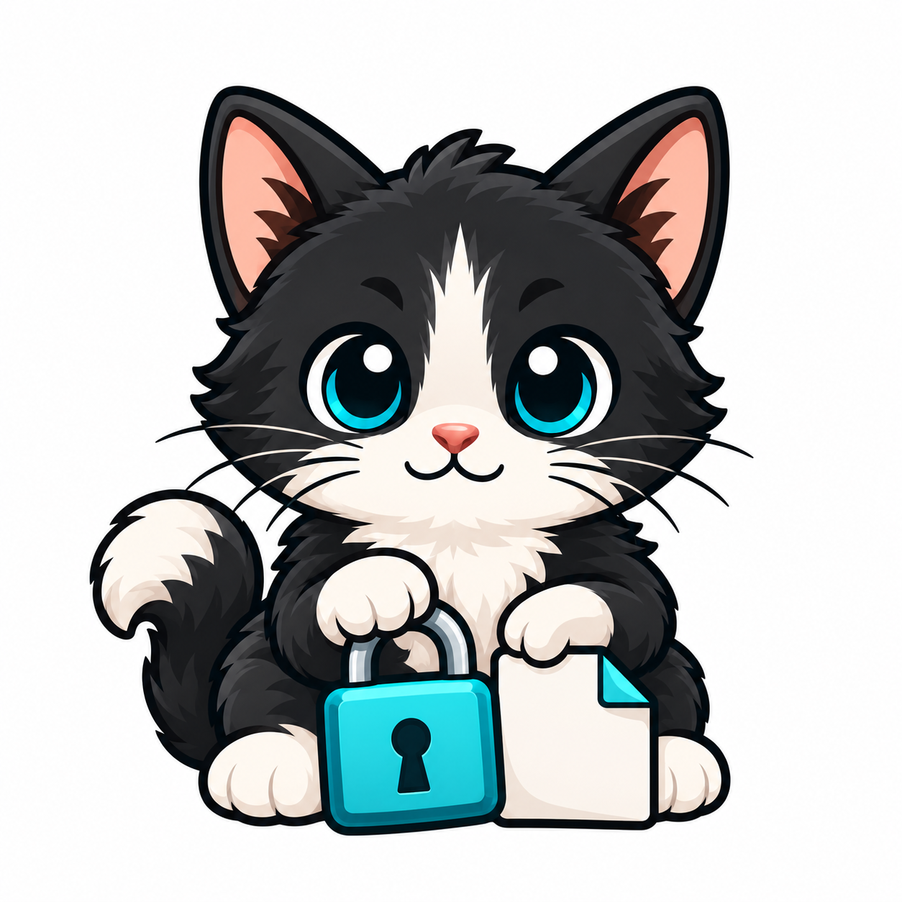
</p>

This PoC based on [malware and cryptography series](https://cocomelonc.github.io/malware/2026/03/05/malware-cryptography-44.html) from my [blog](https://cocomelonc.github.io/)    

Meoware EDU is a standalone C/Win32 ransomware behavior lab for educational and defensive research. It creates an empty, unique temporary lab folder. The operator places disposable corpus files there, and the GUI recursively processes regular files under that folder with the selected educational cipher. File I/O uses fixed-size buffers; memory use does not grow with file size. Restore uses the session key and per-file authenticated records held by the current process. The optional deadline scenario removes only the encrypted records created by that lab session.

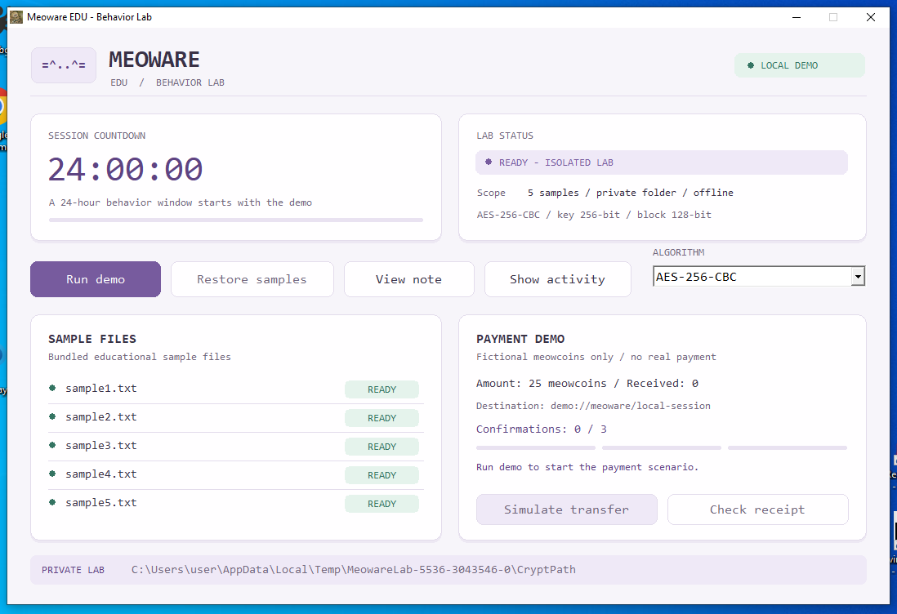    

The lab directory is created under the current user's Windows temporary directory and is shown in the GUI. Use **Open lab folder** to copy in disposable generated fixtures. The application processes only files under this private lab path; it does not accept arbitrary target paths or enumerate drives. Symbolic links and junctions are rejected. The application does not register file associations or touch the registry. Its payment demo uses the Telegram Bot API to exchange a fictional meowcoins request and operator-approved demo receipt; no real payment is requested or verified.

The lab no longer embeds or assumes a fixed sample list. The corpus can be generated separately and copied into the displayed lab folder. The C implementation separates the Win32 UI, lab workflow, cipher dispatch, portable cipher modules, and receipt flow. AES, random key/IV generation, and HMAC-SHA-256 use Windows CNG.

## Algorithms

Choose an algorithm in the `ALGORITHM` list before clicking `Run demo`. AES is the default. The selection locks when the session starts; direct restoration and mock-payment restoration both use that session's cipher and key. Restart the application to try another algorithm in a fresh lab.     

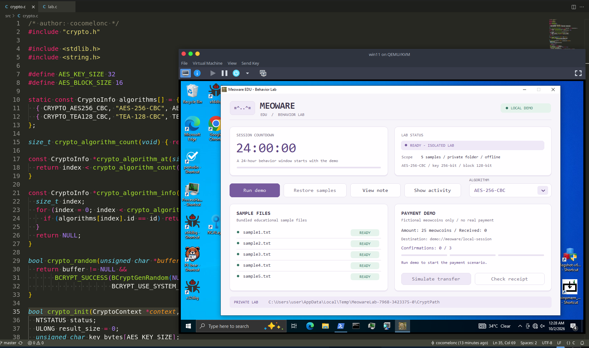    

| GUI option | Key | Block / IV | Implementation |
| --- | --- | --- | --- |
| AES-256-CBC | 256 bits | 128 bits | Windows CNG |
| TEA-128-CBC | 128 bits | 64 bits | Classic TEA, 32 cycles (64 half-rounds), explicit big-endian words: based on [blog](https://cocomelonc.github.io/malware/2023/02/20/malware-av-evasion-12.html) |
| XTEA-128-CBC | 128 bits | 64 bits | Extended TEA, 32 cycles (64 half-rounds), explicit big-endian words: based on [blog](https://cocomelonc.github.io/malware/2023/11/23/malware-cryptography-22.html) |
| RC5-128-CBC | 128 bits | 64 bits | RC5-32/12/16, 12 rounds, explicit little-endian words: [blog](https://cocomelonc.github.io/malware/2023/08/13/malware-cryptography-1.html)|
| RC6-128-CBC | 128 bits | 128 bits | RC6-32/20/16, 20 rounds, explicit little-endian words: [blog](https://cocomelonc.github.io/malware/2024/02/21/malware-cryptography-25.html) |
| A5/1 | 64 bits | Stream / 22-bit COUNT in 3 bytes | Majority-clocked 19/22/23-bit LFSRs; continuous file keystream, no GSM burst framing or padding; educational only ([blog #27](https://cocomelonc.github.io/malware/2024/05/12/malware-cryptography-27.html)) |
| Skipjack-80-CBC | 80 bits | 64 bits | 32 rounds, alternating A/B rules, big-endian words ([blog #20](https://cocomelonc.github.io/malware/2023/08/28/malware-cryptography-20.html)) |
| Camellia-128-CBC | 128 bits | 128 bits | 18 rounds, FL/FLINV layers, big-endian words; RFC 3713 ([blog #38](https://cocomelonc.github.io/malware/2024/12/29/malware-cryptography-38.html)) |
| Speck-128-CBC | 128 bits | 128 bits | Speck128/128, 32 rounds, ARX operations, reference little-endian byte/word order ([blog #42](https://cocomelonc.github.io/malware/2025/05/29/malware-cryptography-42.html)) |
| MARS-128-CBC | 128 bits | 128 bits | IBM MARS with 128-bit key profile, full key expansion and 32-round structure ([blog #43](https://cocomelonc.github.io/malware/2025/07/16/malware-cryptography-43.html); implementation follows the [IBM specification and vectors](https://shaih.github.io/pubs/mars/index.html)) |

All block cipher modes use `PKCS#7` padding, a fresh random session key, and a fresh IV per file. Streaming CBC state is maintained across fixed-size reads. Each MWA3 record is authenticated with HMAC-SHA-256 before restoration is committed. TEA and XTEA have separate block implementations and share CBC/padding handling in `src/cbc.c`. Cipher implementations remain educational; this lab is not a production file-encryption product.

For TEA: the algorithm selection follows the cryptography series in [my blog](https://cocomelonc.github.io/malware/2023/02/20/malware-av-evasion-12.html). The C snippet in that article uses XTEA-style mixing despite its TEA function names. This implementation follows [Wheeler and Needham's original TEA specification](https://www.cl.cam.ac.uk/ftp/papers/djw-rmn/djw-rmn-tea.html), with known-answer tests from [Crypto++'s TEA vectors](https://github.com/weidai11/cryptopp/blob/master/TestVectors/tea.txt). Other algorithms will be added separately.     

XTEA follows the 32-cycle construction in [Needham and Wheeler's Tea extensions](https://www.cix.co.uk/~klockstone/xtea.pdf), checked against independent known-answer vectors from [Crypto++](https://github.com/weidai11/cryptopp/blob/master/TestVectors/tea.txt) and [Mbed TLS](https://github.com/Mbed-TLS/mbedtls/blob/mbedtls-2.28.9/library/xtea.c). To try an algorithm, copy disposable fixtures into the displayed lab folder, choose it in the GUI, click `Run demo`, then click `Restore lab`.

The algorithm catalog in `src/crypto.c` supplies the GUI names, IDs, and sizes. MWA3 records contain a 32-byte header (`MWA3`, algorithm ID, IV length, reserved flags, original 64-bit size, and IV slot), streamed ciphertext, and a 32-byte HMAC-SHA-256 tag. The tag covers the header and ciphertext. Restore authenticates and decrypts into a temporary file; it renames that file to its original relative path only after authentication and size checks pass. Session keys remain in process memory, so there is no cross-session restore. Older MWA2 records are not read by this version.

## build with MinGW-w64

From this directory:    

```bash
make all
```

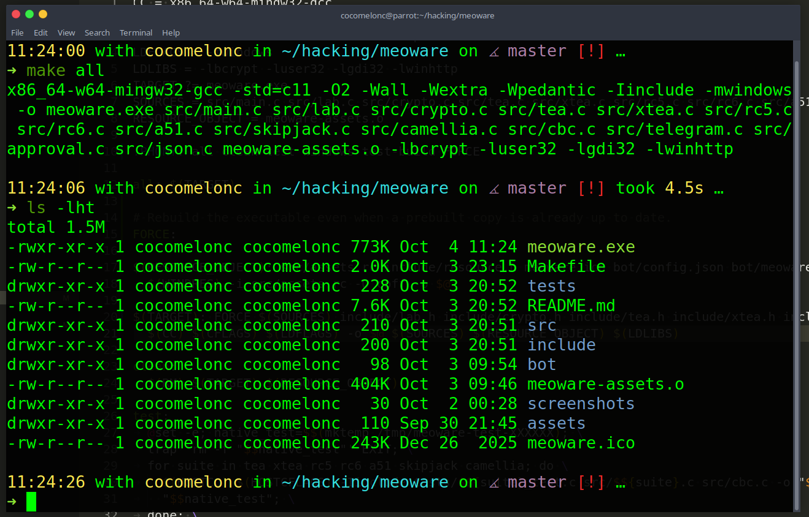    

Or invoke the compiler directly:    

```bash
x86_64-w64-mingw32-windres -i src/assets.rc -O coff -o meoware-assets.o
x86_64-w64-mingw32-gcc -std=c11 -O2 -Wall -Wextra -Wpedantic \
  -Iinclude -mwindows -o meoware.exe \
  src/main.c src/lab.c src/crypto.c src/tea.c src/xtea.c src/rc5.c src/rc6.c \
  src/a51.c src/skipjack.c src/camellia.c src/speck.c src/mars.c src/cbc.c \
  src/telegram.c src/approval.c src/json.c meoware-assets.o \
  -lbcrypt -luser32 -lgdi32 -lwinhttp -lshell32
```

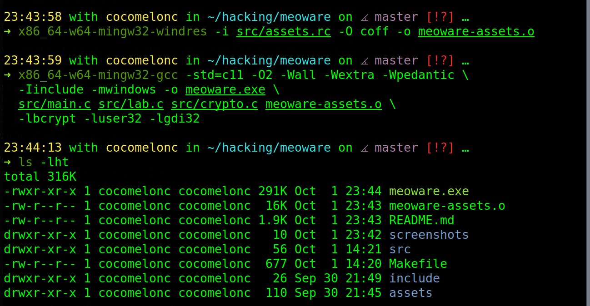     

The build does not require Visual Studio or MFC. It embeds no corpus files; the lab folder is created at runtime and populated by the operator.

## Ransomware lab behavior

`Run demo` first enumerates the complete tree and rejects reparse points, excessive nesting, path overflow, and existing output collisions. It streams each file into a temporary authenticated record while keeping every source in place. Only after all records are staged and committed does it remove source copies. If a later removal fails, the session keeps the recovery manifest and enables `Restore lab`; restore handles both files already removed and source/output pairs left by a partial run. Restore writes to temporary files, checks HMAC and original length, then restores the original relative paths and basic timestamps. The deadline branch removes only session records. The lab directory is left in the temp folder for inspection.

## Payment simulation

The payment flow is a Telegram-mediated demo, with confirmation. The Windows GUI calls Telegram's Bot API directly with WinHTTP. Configure a dedicated test bot and private `chat_id` in `bot/config.json`, then rebuild with `make`; the bot token is embedded in the resulting executable, so use test credentials only. Start the bot chat with `/start` before running the demo.    

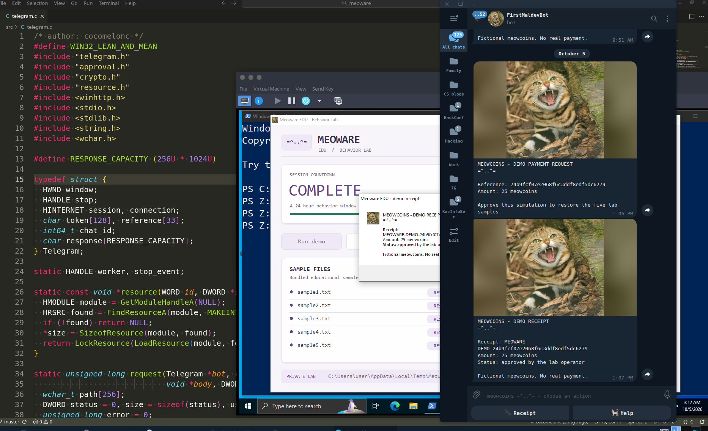    

Click `Run demo`, then `Simulate transfer`. The GUI sends a cat-image payment request for 25 fictional meowcoins to the configured Telegram chat.       

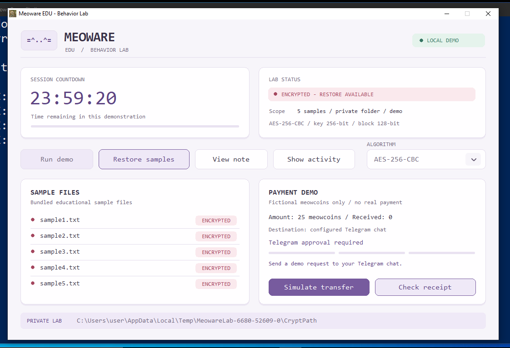    

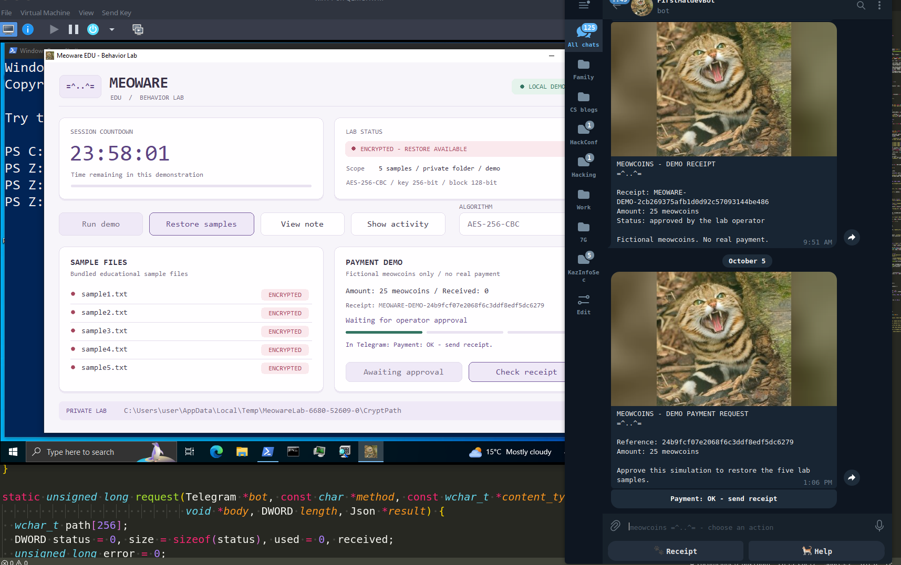    

In that chat, press `Payment: OK - send receipt` on the request. The GUI polls for the callback and checks that it matches the configured chat and current session.    

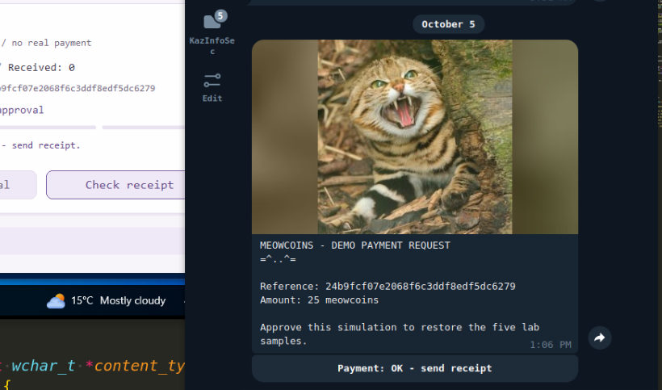    

After approval, the bot sends a demo receipt to the chat and the GUI displays it and restores the lab files. `Check receipt` shows the current status; `Retry transfer` is available after a network error, and each retry uses a new session reference.

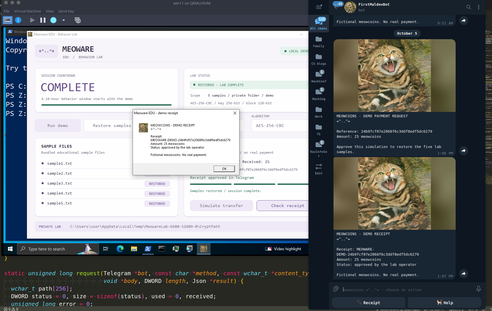    

The GUI is the only update consumer for this bot token: stop other polling clients and do not configure a webhook for it. An existing webhook or competing poller prevents the approval flow from working. No real money, wallet, or blockchain is involved; the amount and receipt are fictional. The request sends only the demo amount, a random session reference, and fixed demo text, not encryption keys, sample contents, paths, or machine information. `Restore lab` remains available for local recovery regardless of Telegram status.

Run the portable receipt, TEA, and XTEA tests with a host C compiler (no Windows or Wine needed). These cover published cipher vectors, CBC chaining, padding rejection, buffer boundaries, in-place operations, and exact restoration of the five bundled samples:

```bash
make test
```

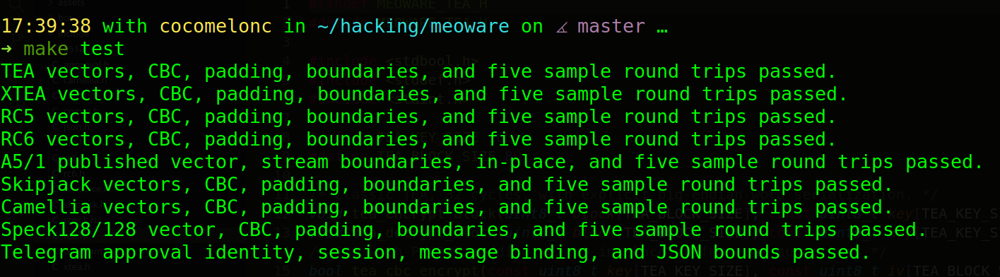    

Build the Windows integration tests with `make windows-test-build`. Run the resulting `/tmp/meoware-lab-tests.exe` on Windows or under Wine to check cipher dispatch, streaming recursive processing of nested fixtures, authenticated restoration, and the deadline branch. The tests create their own temporary labs and remove them after successful checks.
