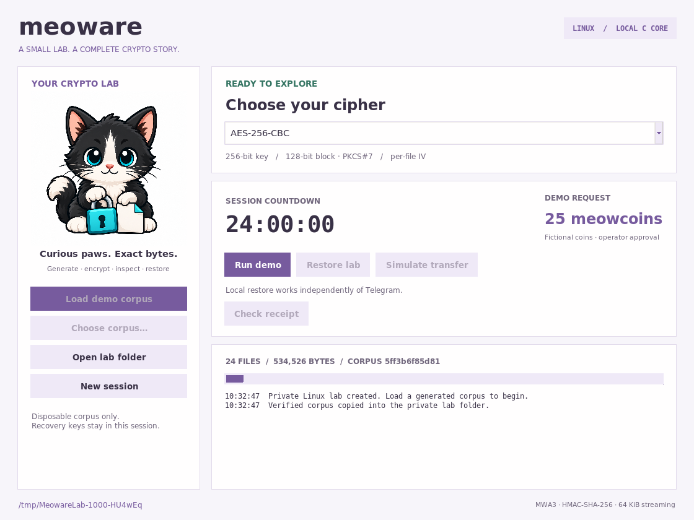
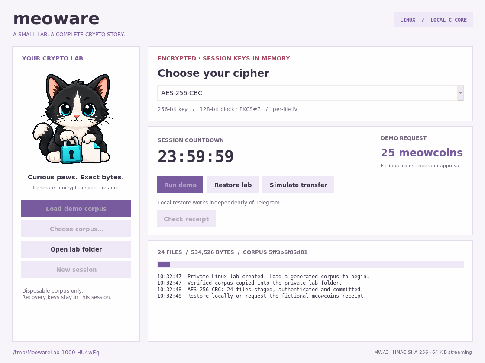
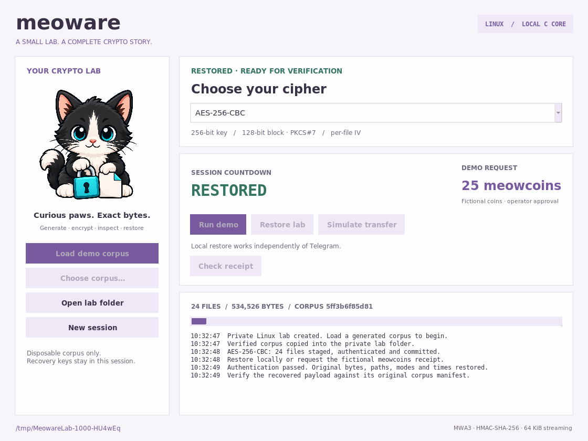

# Meoware EDU · Linux desktop

Linux GUI with the shared C cipher modules, a native C/POSIX lab engine, OpenSSL 3 for AES/randomness/HMAC and a Python/Tkinter interface. All 12 cipher profiles use the common MWA3 record specification. The shared Python corpus generator supplies the same fixtures used by the Windows laboratory.

## Build and run

Requirements: GCC, OpenSSL 3 development headers/libraries, Python 3.10+ and Tkinter. No GTK, Qt, Wine or Telegram Python package is required.

From the repository root:

```bash
mkdir -p linux/build
gcc -std=c11 -O2 -Wall -Wextra -Wpedantic -Werror -fPIC -shared -Iinclude -o linux/build/libmeoware.so src/linux_lab.c src/crypto.c src/tea.c src/xtea.c src/rc5.c src/rc6.c src/a51.c src/skipjack.c src/camellia.c src/speck.c src/mars.c src/safer.c src/feal8.c src/cbc.c src/approval.c src/json.c -lcrypto
python3 -m linux
```

The GUI uses the existing Meoware artwork. It shows the cipher, session countdown, private path, journal, local restoration and meowcoins controls. Native file operations run on a worker thread; Tk widgets are updated on the main thread.

## Use the shared corpus

Generate once, or verify and reuse the existing `smoke-42` directory:

```bash
python3 -m tools.corpus generate --profile tools/corpus/profiles/smoke.json --seed 42 --output datasets/corpora/smoke-42
python3 -m tools.corpus verify --corpus datasets/corpora/smoke-42
```

Click **Load demo corpus**, or use **Choose corpus…** to select a generated corpus directory containing `manifest.json`, `files.jsonl` and `payload/`. Import validates the corpus and copies only its payload into a fresh private lab. Manifests remain outside the processed tree. **Open lab folder** shows that directory for inspection.

Choose a cipher, click **Run demo**, then **Restore lab**. Verify the result with the path shown in the GUI:

```bash
python3 -m tools.corpus verify --corpus datasets/corpora/smoke-42 --payload /tmp/MeowareLab-UID-SESSION
```

**New session** creates an empty directory before encryption, after restoration or after expiry. The previous directory remains available for inspection. Session keys are memory-only; keep the application open until restoration completes.







## Meowcoins through the Telegram Bot API

The GUI reads the existing `bot/config.json` at runtime, with the same `token` and positive private `chat_id` fields as Windows. `MEOWARE_TELEGRAM_CONFIG` can point to a different configuration file. Credentials are not embedded into the Linux shared library or displayed in the journal.

Open the dedicated test bot chat and send `/start`. With an encrypted lab active, click **Simulate transfer**, approve **Payment: OK - send receipt** in that chat, and receive the fictional 25-meowcoins receipt. Approval checks the operator, private chat, message ID and current random session reference using the shared C validator. Only after the receipt is sent does the GUI request local restoration.

Only one client may poll a bot token. Stop the Windows GUI before using the same bot from Linux, or configure separate test bots. An existing webhook is reported and left unchanged. Network failures expose **Retry transfer**; local restoration remains available independently of Telegram. Cancellation and session identity prevent a late response from restoring a different session.

Requests contain only fixed demo text, fictional amount, a random reference and the existing cat image. No corpus data, encryption keys or local paths are transmitted. Real Bot API calls use verified HTTPS and refuse redirects. Network activity starts only when the operator clicks the transfer button.

## Native behavior and limits

- Only the private `/tmp/MeowareLab-UID-XXXXXX` created by the C engine is a processing target; there is no arbitrary-target encryption API.
- The root is held by a directory descriptor. Relative operations walk directories with `openat`/`O_NOFOLLOW`; symbolic links, hard links, devices and FIFOs are rejected.
- Limits: 256 MiB payload, 100000 regular files and 64 nested directories per session. File-data buffers are 64 KiB; manifest memory grows with file count.
- Records are fully staged before originals are removed. Exclusive creates and no-replace renames reject output collisions. A modified or substituted original is not removed.
- Restore verifies every committed record before committing recovered files. It checks algorithm/header/length, HMAC and the original plaintext authentication value, then restores relative paths, ordinary mode bits and access/modification times. ACLs, extended attributes and ownership migration are outside this PoC.
- The countdown starts after encryption. Expiry removes only records recorded by this session; files added afterward are left alone. The expiry operation is a laboratory deletion scenario, not secure erasure.
- MWA3 IDs, header layout, padding and portable streaming code are shared with Windows. Keys and session manifests are not exported, so cross-session restoration is not an application feature.

## Verification

Headless engine and mock Telegram tests:

```bash
python3 -m unittest discover -s tests/linux -v
```

Real GUI tests on an X11 desktop:

```bash
MEOWARE_GUI_TESTS=1 python3 -m unittest discover -s tests/linux -v
```

The Linux suite checks all 12 profiles against the original `smoke-42` manifest, boundary sizes, nested/Unicode paths, modes/timestamps, tampering and truncation, collision/link rejection, root-descriptor anchoring, expiry and GUI actions. Telegram tests use mock API responses: receipt approval, identity/reference rejection, cancellation, webhook refusal and receipt failure. They send no external messages.

Native known-answer and sanitizer checks:

```bash
gcc -std=c11 -O1 -g -Wall -Wextra -Wpedantic -Werror -fsanitize=address,undefined -fno-omit-frame-pointer -Iinclude -o /tmp/meoware-linux-native-tests tests/linux_crypto_test.c src/linux_lab.c src/crypto.c src/tea.c src/xtea.c src/rc5.c src/rc6.c src/a51.c src/skipjack.c src/camellia.c src/speck.c src/mars.c src/safer.c src/feal8.c src/cbc.c -lcrypto
/tmp/meoware-linux-native-tests
```

Measured Linux results and their scope are recorded in [verification.json](verification.json). Windows regression was cross-compiled during this port; a new Windows execution and a Windows-to-Linux session-transfer test were not performed. Live Telegram delivery is verified separately by an operator using the transfer control; automated results concern the mock API workflow.
